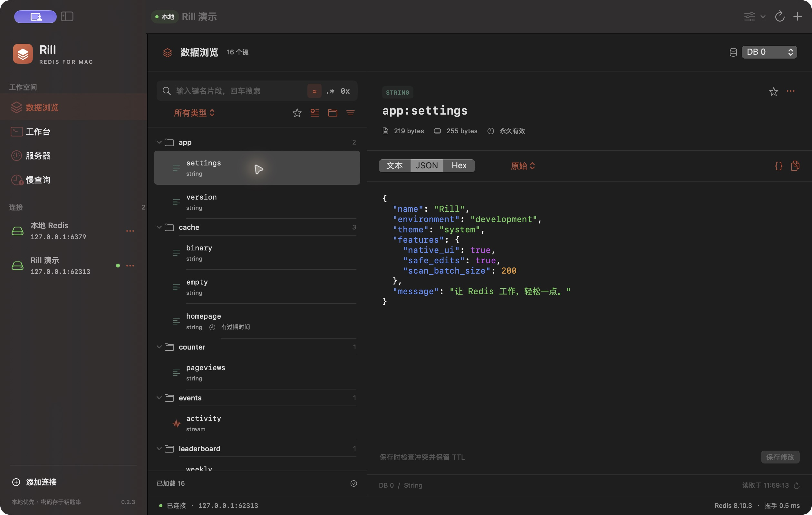
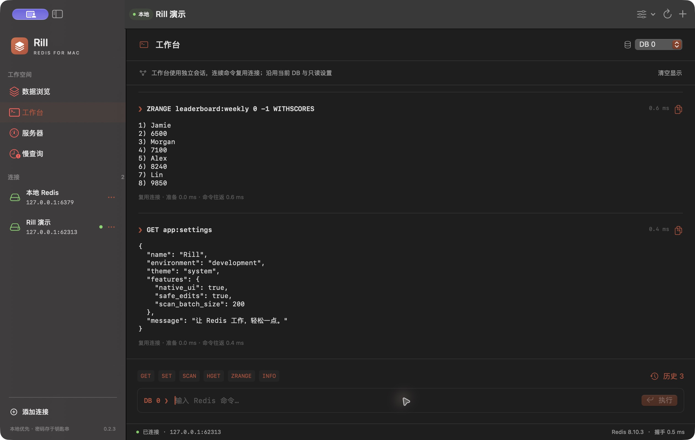
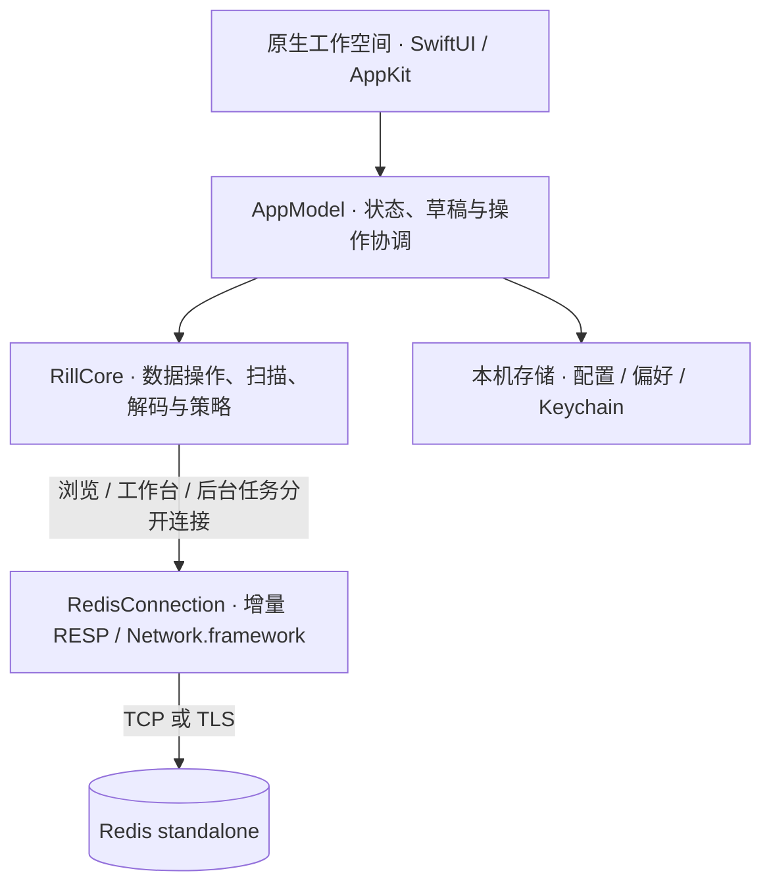

<div align="center">


# rill

**让 Redis 工作，轻松一点。**

A native Redis workspace for Mac.

当前源码版本 **v0.2.6**。查看 [更新说明](docs/releases/v0.2.6.md) 和 [代码审核记录](docs/audits/2026-11-03.md)。

<p>
  
  
  
</p>

[功能](#功能) · [快速开始](#快速开始) · [设计理念](#设计理念) · [参与开发](#参与开发) · [文档](docs/README.md)

</div>

rill 是一个 **macOS 原生 Redis 客户端**，支持键浏览、数据编辑、命令执行和服务器状态查看。

使用 SwiftUI 和 AppKit 构建界面，通过 Network.framework 直连 Redis，密码保存在 macOS 钥匙串中，应用更新使用 Sparkle 2。

截图使用隔离演示数据；以下画面来自 v0.2.3，当前命名和更新入口以 v0.2.6 为准。



## 功能

### 键浏览与搜索

- **三种查找方式**：输入键名片段、使用 Redis glob，或通过 Hex 定位原始键字节。
- **按业务组织键**：多层命名空间、自定义分隔符、键收藏、保存搜索；按连接和 DB 恢复浏览偏好。
- **逐步加载**：基于 `SCAN` 分批浏览，可停止、继续；先显示键名，再获取可见行所需的类型和 TTL。
- **键信息**：查看类型、过期时间、值大小和内存占用；可调整栏宽，按需隐藏列表列。

### 数据查看与编辑

| 数据类型 | 可以做什么 |
| --- | --- |
| String | 文本 / JSON / Hex 查看，无损 JSON 格式化，Base64、Gzip 及组合解码 |
| Hash | 字段和值表格编辑，服务端 `MATCH` 查找 |
| List | 分页读取、按项编辑，过滤已加载内容 |
| Set | 成员浏览、新增与删除，服务端 `MATCH` 查找 |
| ZSet | 成员与分值编辑，服务端 `MATCH` 查找 |
| Stream | 默认最新优先，双向读取、ID 范围、条目查看与操作 |

String 编辑将原始字节、解码视图和草稿分开：格式化保留大数、字段顺序和重复字段，保存前显示逆向编码后的字节数；提交时检查原值冲突并保留 TTL。二进制或超出预览上限的字符串保持只读。

支持六种类型新建键、拒绝覆盖的重命名与同库复制、设置过期时间、`UNLINK` 删除，以及当前页导出和版本化完整单键导出。

### 命令工作台

命令名补全保留已有参数，离线帮助随输入展示；连接准备与命令往返分别计时，结果可以直接复制。按 **⌃R** 搜索历史，用方向键选择、回车填入，确认后再执行。

工作台使用独立于数据浏览的 Redis 连接，连续命令复用会话；历史按连接和 DB 隔离，仅保存在本次应用会话中。



### 服务器状态

- **服务器概览**：查看 `INFO` 中的版本、内存、连接等状态。
- **短窗口趋势**：主动开启采集，按需停止。
- **内存分析**：在键数量、请求数和时间预算内检查当前 DB 的部分键。
- **慢查询**：同时显示服务端阈值、耗时单位和采集时间。
- **命令支持情况**：查看服务器是否支持相关命令，以及 ACL 权限错误。

### 应用内更新

默认每天静默检查；发现新版后在侧栏提示，也可从 **rill 菜单 → 检查更新…** 或 **rill 菜单 → 关于 rill** 手动检查。关于窗口同时显示版本与构建号。更新窗口展示改动说明，下载的更新源和安装包经过签名验证。安装前检查草稿、写入和导出状态，由用户决定继续。详见 [更新与发布](docs/updates.md)。

## 快速开始

### 从源码构建

| 条件 | 要求 |
| --- | --- |
| 系统 | macOS 14 或更新版本 |
| 构建工具 | Xcode / Swift 6.0+ 工具链，包含 macOS SDK |
| Redis | 面向 Redis 6.2+ standalone；本机或远程实例均可 |
| 可选工具 | 本地演示需 `redis-server` 和 Python 3；导出校验需 Python 3 |

获取源码并进入仓库：

```sh
git clone https://github.com/jinsihou19/rill.git
cd rill
```

在项目根目录执行：

```sh
./scripts/build-app.sh --open
```

构建完成后会打开 `build/rill.app`。将它复制到「应用程序」目录即可安装。

重新构建前先退出目标应用；脚本会拒绝替换正在使用的应用包。如需并行运行，可用 `RILL_BUILD_APP_PATH` 指定其他输出路径。若保存连接时报 `UNIX[No such file or directory]`，且应用刚被构建替换，请退出并重新打开后重试。

也可以在 Xcode 中打开 `Package.swift`，或直接运行：

```sh
swift run rill
```

### 先用演示数据体验

已安装 Homebrew 时，可用它安装本地演示所需的 Redis：

```sh
brew install redis           # 已有 redis-server 可跳过
./scripts/build-app.sh       # 已构建可跳过
./scripts/demo.sh
```

脚本会启动一个使用随机本地端口的临时 Redis，写入六种数据类型的示例并打开 rill。退出应用后自动清理演示实例和数据。

### 连接自己的 Redis

1. 点击左下角「添加连接」，填写地址、端口、DB 和环境标识；按需启用 ACL 认证、TLS 与只读模式。
2. 测试连接并保存，选择连接进入数据浏览。
3. 按 **⌘F** 输入键名片段，回车查找；选择键查看详情，按 **⌘2** 打开工作台。

更多操作见 [使用指南](docs/user-guide.md)。

## 设计理念

| 设计 | 实现 |
| --- | --- |
| 原生界面 | 系统表格、文本编辑器、文件面板与快捷键，跟随 macOS 明暗外观 |
| 按需加载 | 先显示键名，再读取可见行的元数据；扫描可暂停和继续 |
| 保留原始数据 | 使用原始字节标识键和成员，将显示格式、解码结果与编辑草稿分开 |
| 编辑保护 | 提供只读模式、生产写入确认、原值冲突检查与未保存提醒 |
| 连接隔离 | 浏览、命令工作台和后台任务分别管理连接，避免相互改变会话状态 |



模块划分见 [架构与设计](docs/design.md)。

## 连接与数据

| 项目 | 说明 |
| --- | --- |
| 凭据与配置 | 密码存于 macOS Keychain；连接 JSON 不含密码，文件权限为 `0600` |
| 生产写入 | 初次选择生产环境时默认只读；关闭只读后，写入仍需输入连接名称确认 |
| 命令策略 | 未知 / 模块命令按写入对待；工作台限制事务、订阅、阻塞、会话切换及服务器管理命令 |
| TLS | 支持使用系统信任证书的 TLS 连接 |
| 浏览范围 | 收藏筛选与命名空间计数基于已加载键；`SCAN` 不提供一致性快照 |
| 导出 | 支持当前页导出和完整单键 JSONL 导出，包含完整性标记与摘要 |
| 写入失败 | 不自动重试；超时或断线时结果可能未知，需要刷新核对 |

面向 Redis 6.2+ standalone；已验证环境及兼容性边界见 [审核与验证记录](docs/audits/2026-11-03.md)。暂不支持 Cluster / Sentinel 路由、内建 SSH 隧道、Pub/Sub、模块编辑器、全库迁移或批量删除。

配置位置和读取上限见 [使用指南](docs/user-guide.md#数据存储与资源上限)，导出文件说明见 [单键导出格式](docs/key-export-format.md)。

## 快捷键

| 操作 | 快捷键 |
| --- | --- |
| 添加连接 / 新建键 | ⇧⌘N / ⌘N |
| 搜索键 / 刷新当前页 | ⌘F / ⌘R |
| 保存字符串值 | ⌘S |
| 数据浏览 / 工作台 / 服务器 / 慢查询 | ⌘1 / ⌘2 / ⌘3 / ⌘4 |
| 执行命令 | ⌘↩，或命令输入框内回车 |
| 浏览 / 搜索命令历史 | 输入框内 ↑ ↓ / ⌃R |
| 停止键扫描 | Esc |

## 参与开发

工程由 Swift Package Manager 管理，核心逻辑与界面分开：

```text
Sources/
├── RillApp/          # 原生界面、应用状态、配置与 Keychain
└── RillCore/         # RESP、连接、数据操作、扫描、解码与导出
Tests/
├── RillCoreTests/    # 协议、策略与独立 Redis 集成测试
├── RillAppTests/     # 原生编辑选区与应用状态回归
└── Support/          # 核心和界面测试共用的脚本化服务
scripts/             # 构建、演示、存储检查、导出校验与性能实验
assets/              # 应用包配置
docs/
├── images/          # 应用图标与真实演示截图
├── releases/        # 逐版本说明
├── user-guide.md    # 完整使用指南
└── design.md        # 架构与设计理念
```

在项目根目录运行：

```sh
swift test
./scripts/verify-storage.sh
./scripts/build-app.sh
```

协议与策略单测不依赖服务。集成测试自动启动仅监听 `127.0.0.1` 的临时 Redis，使用随机端口和独立目录；缺少 `redis-server` 时会明确跳过。存储检查用临时配置目录和随机 UUID 的合成密码验证配置与 Keychain，结束后清理测试项。

欢迎提交 Issue 和 PR。报告问题时请附 macOS、Redis 和 rill 版本、复现步骤及脱敏后的错误信息。修改协议或数据读写逻辑时，请补充相应测试。

## 文档

- [使用指南](docs/user-guide.md)：连接、搜索、编辑、工作台、诊断与常见问题。
- [架构与设计](docs/design.md)：模块职责、连接隔离、资源预算与数据保护。
- [单键导出格式](docs/key-export-format.md)：JSONL、完整性检查、二进制和过期策略。
- [更新与发布](docs/updates.md)：更新入口、签名校验与发布工作流。
- [代码审核与验证](docs/audits/2026-11-03.md)：本轮发现、修复、回归与未验证边界。
- [竞品调研与功能边界](docs/research-and-scope.md)：亮点对比、源码研究和迁移计划。
- [版本记录](docs/README.md)：各版本更新说明。
