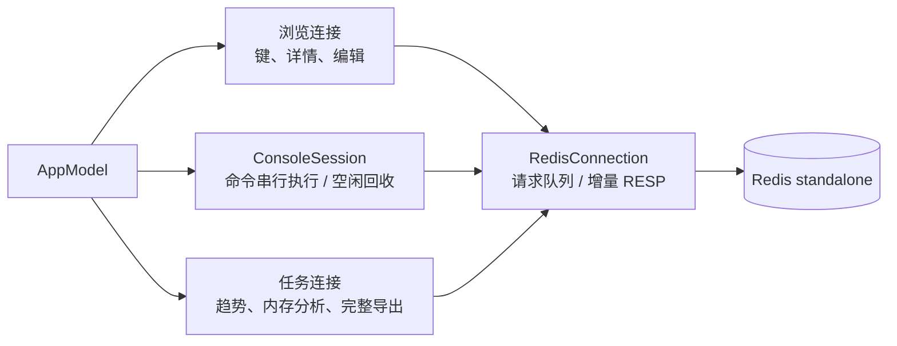

# rill 架构与设计

[项目首页](../README.md) · [文档目录](README.md)

工程分为 `RillApp` 和 `RillCore` 两个模块：前者负责界面与应用状态，后者负责 Redis 协议、数据操作和命令策略。

## 原生界面

界面采用 SwiftUI 组织工作空间，使用 AppKit 补充文本编辑和可见行感知等能力。三栏布局让连接、键空间与当前数据同时可见；表格列宽、文件面板、键盘操作和系统明暗外观遵循 macOS 习惯。

搜索快捷键在当前工作空间内生效，选择历史命令后填入输入框，离开未保存的草稿前弹出确认。

## 数据表示

Redis 键名、字段和成员可能包含任意字节。核心模型使用 `Data` 标识数据，命名空间分组和收藏使用原始键字节，Hex 查找直接按字节定位。

String 编辑保留三个不同的对象：读取时的原始字节、选定解码后的内容、用户正在编辑的草稿。JSON 格式化保留数字文本、字段顺序与重复字段；解码转换有明确的逆向编码路径。查看或格式化不会自动提交修改。

单键导出使用 JSONL 格式，以 Base64 编码原始字节，并记录格式版本、过期时间、摘要和完成状态。

## 按需加载

键浏览先扫描名称，只为可见行请求所需元数据；隐藏列不查询，本轮已读取的信息可以复用。命令工作台复用专用连接，避免每条命令都重新认证与选库。

`KeyScanSession` 和 `MemberReadSession` 保存游标、去重集合与待展示结果。读取受结果数、请求数、时间和累计字节预算控制。暂停在响应边界生效，已经取得的结果留给下一轮继续使用。

达到缓存上限后停止继续加载，并提示缩小查询范围。

## 连接管理

图中的传输层是公共实现，每条实际连接各自持有请求与解码状态。工作台不会借用浏览连接改变会话状态；切库、配置或认证变化会关闭旧命令会话。趋势、内存分析和完整导出使用任务连接，便于分别停止和回收；概览刷新与慢查询复用浏览连接。

`RedisConnection` 以串行队列协调网络状态与请求，增量 RESP 解码器处理分包、流水线剩余数据和大小限制。协议、断线、取消和超时错误向调用者明确传播；写入失败不自动重放。

## 写入处理

界面和核心数据操作入口都检查只读状态。未知命令按写入处理；工作台限制会话切换、事务、订阅、阻塞及管理操作。

生产连接启用写入后需要输入连接名称确认。String 保存时在服务端检查原值，通过 `KEEPTTL` 保留过期时间；重命名与复制拒绝覆盖已有键。集合编辑根据操作检查目标成员的原值或结构。

写入超时后不自动重试，界面提示刷新核对结果。服务端访问权限由 Redis ACL 控制。

## 权限与命令支持

`RedisCapabilities` 根据请求结果记录命令支持情况和权限错误。`INFO`、TTL 或内存查询失败时，对应信息显示为未知。服务器不支持 `SCAN TYPE` 时，在扫描结果中检查类型。

诊断数据显示采集时间和单位，命名空间计数使用已加载的键数。

## 模块职责

| 位置 | 职责 |
| --- | --- |
| `Sources/RillApp/WorkspaceView.swift` | 三栏工作空间、查找入口与导航 |
| `Sources/RillApp/KeyDetailView.swift`、`Editors.swift` | 值与成员查看、编辑表单、确认交互 |
| `Sources/RillApp/DiagnosticsView.swift`、`ConsoleHistoryView.swift` | 命令工作台、历史、服务器与慢查询界面 |
| `Sources/RillApp/AppModel.swift` | 应用状态、任务协调、草稿、选择与操作生命周期 |
| `Sources/RillApp/Persistence.swift` | 配置文件、浏览偏好与系统 Keychain |
| `Sources/RillCore/RedisDatabase.swift` | 类型相关读取、分页、编辑、键操作与服务端检查 |
| `Sources/RillCore/RedisConnection.swift`、`RESP*.swift` | TCP / TLS、请求队列、协议编解码与结果预览 |
| `Sources/RillCore/KeyScanSession.swift`、`MemberReadSession.swift` | 游标、预算、暂停与容量控制 |
| `Sources/RillCore/KeyNamespaceTree.swift` | 保留字节身份的多层命名空间 |
| `Sources/RillCore/ValueCodec.swift`、`JSON*.swift` | 编码转换、无损格式化与高亮 |
| `Sources/RillCore/Models.swift`、`CommandGuide.swift` | 模型、命令解析与策略、离线帮助和历史 |
| `Sources/RillCore/Capabilities.swift`、`Diagnostics.swift` | 能力观察、趋势与有预算的内存分析 |
| `Sources/RillCore/KeyExport.swift` | 版本化单键导出、部分文件、摘要与完成标记 |

`RillCore` 不依赖界面模块，可以独立测试协议与数据操作。

## 应用更新

`AppUpdater` 持有 Sparkle 应用级控制器，通过 KVO 同步 SwiftUI 状态。自动检查只更新侧栏提示，用户主动操作才显示标准更新窗口；重启前检查草稿和正在执行的操作，必要时保留恢复句柄，等待用户再次继续。更新组件只属于 `RillApp`，`RillCore` 仍可独立使用和测试。

版本、密钥、更新源和发布规则见 [更新与发布](updates.md)。

## 测试

测试分为协议与策略单测、脚本化网络响应测试、临时真实 Redis 集成测试。临时实例只监听回环地址，使用随机端口与独立目录；配置与 Keychain 检查使用合成测试项。

读写测试覆盖原始字节、TTL、权限拒绝和错误处理。布局、快捷键和文件面板通过原生界面检查。
